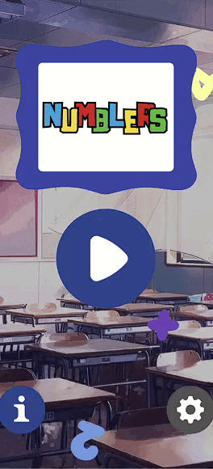
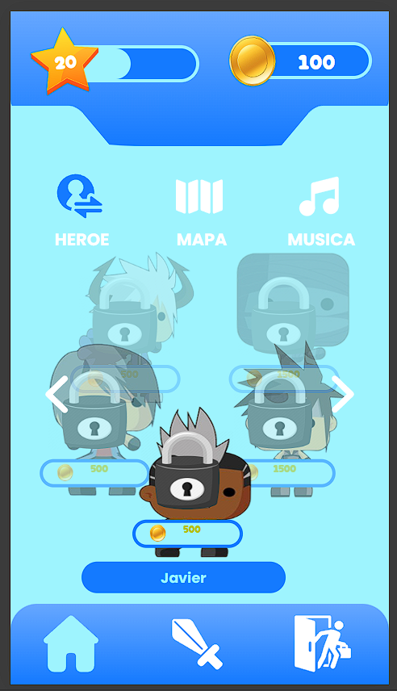
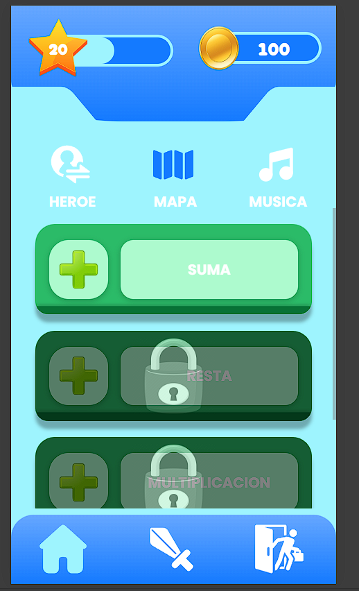
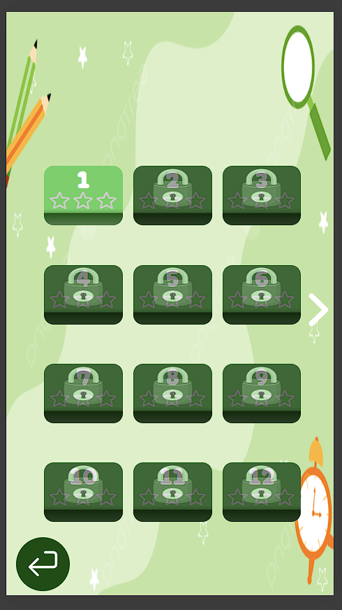
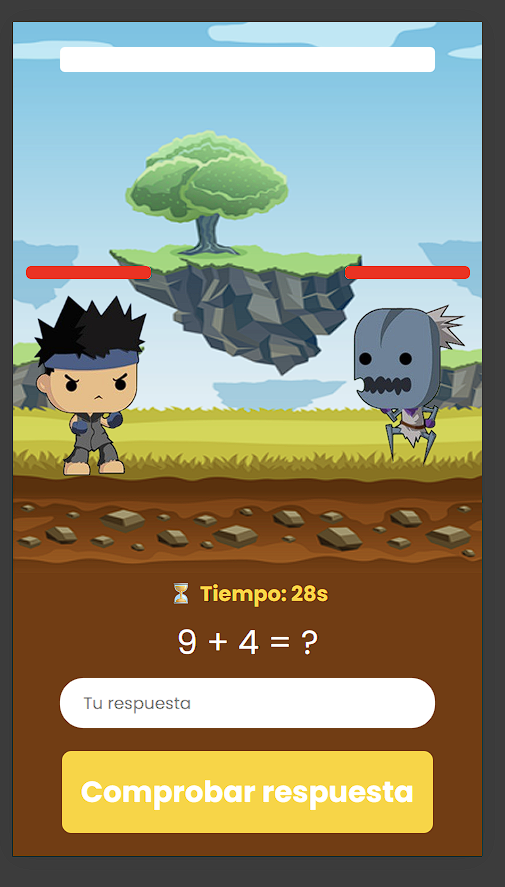

<!--proyect_tittle-->
# 🧮 Numblers – Videojuego Educativo de Matemáticas

<!--proyect_image1_proyect_markdown/image1.gif-->

---

<!--proyect_subtitle_description-->
## ✨ Descripción del Proyecto

<!--proyect_content_description-->
**Numblers** es un videojuego educativo desarrollado en **React Native** con un motor de juego personalizado, diseñado para enseñar matemáticas de forma divertida e interactiva. Utiliza **Docker** para facilitar el despliegue, la modularidad y la escalabilidad del sistema.

El juego combina mecánicas clásicas de plataformas con desafíos matemáticos adaptados a distintos niveles de dificultad. A través de personajes animados, mapas temáticos y música envolvente, los jugadores aprenden mientras exploran, resuelven problemas y desbloquean contenido educativo.

---

<!--proyect_subtitle_objective-->
## 🎯 Objetivo del Proyecto

<!--proyect_content_objective-->
El objetivo principal de **Numblers** es **fomentar el aprendizaje de las matemáticas** en niños y adolescentes mediante una experiencia visual, progresiva y entretenida. Cada nivel está diseñado para reforzar habilidades como el cálculo mental, la lógica, la resolución de problemas y la memoria numérica.

Además, el uso de tecnologías modernas como React Native y Docker permite que el juego sea multiplataforma, portable y fácil de mantener en distintos entornos educativos.

---

<!--proyect_subtitle_functionality-->
## 🧩 Funcionamiento General

<!--proyect_content_functionality-->
El juego está dividido en cinco secciones principales:

1. **Intro animado:** Presentación del universo de Numblers con música, personajes y ambientación.  
2. **Menú principal:** Vista general de los niveles disponibles, selección de personajes, configuración de sonido y acceso a estadísticas.  
3. **Mapas de niveles:** Exploración visual de mundos temáticos donde se ubican los desafíos matemáticos.  
4. **Selección de niveles:** Pantalla donde el jugador elige el reto específico que desea enfrentar.  
5. **Nivel en ejecución:** Interacción directa con el entorno, resolución de ejercicios, recolección de objetos y avance por plataformas.

<!--proyect_image2_proyect_markdown/image2.png-->

<!--proyect_image3_proyect_markdown/image3.png-->

<!--proyect_image4_proyect_markdown/image4.png-->

<!--proyect_image5_proyect_markdown/image5.png-->

---

<!--proyect_subtitle_designUX-->
## 🖥️ Diseño y Experiencia de Usuario

<!--proyect_content_designUX-->
La interfaz de **Numblers** está diseñada para ser intuitiva, colorida y atractiva para públicos jóvenes. Cada elemento visual está pensado para reforzar el aprendizaje sin distraer del objetivo educativo. Los personajes tienen animaciones suaves, los mapas están ambientados con música temática, y los desafíos se presentan de forma clara y progresiva.

El diseño responsivo permite que el juego se adapte a distintos tamaños de pantalla, desde tablets escolares hasta smartphones personales.

---

<!--proyect_subtitle_architecture-->
## 🏗️ Arquitectura Técnica

<!--proyect_content_architecture-->
**Numblers** está construido sobre una arquitectura modular que permite escalar fácilmente:

- **Frontend móvil:** Desarrollado en React Native con integración de Game Engine para lógica de juego.  
- **Contenedores Docker:** Utilizados para encapsular servicios, facilitar el despliegue y mantener entornos consistentes.  
- **Gestión de escenas:** Navegación entre pantallas mediante control de estado y rutas internas.  
- **Persistencia local:** Uso de almacenamiento interno para guardar progreso, estadísticas y configuraciones.  
- **Backend (futuro):** Planeado para sincronización en la nube, perfiles de usuario y métricas educativas.

---

<!--proyect_subtitle_technologies-->
## 🔧 Tecnologías Utilizadas

<!--proyect_content_technologies-->
**Frontend:**
- React Native  
- Game Engine personalizado  
- Styled Components / CSS-in-JS  

**Infraestructura:**
- Docker  
- Android Emulator / Expo  

**Backend (planeado):**
- Node.js  
- MongoDB / Firebase  
- REST API / WebSocket

---

<!--proyect_subtitle_contact-->
## 📬 Contacto

<!--proyect_content_contact-->
**Correo electrónico:**
- vielmassalais023@gmail.com  

**Teléfono:**
- +52 (81) 3233-1206  

**Redes Sociales:**
- GitHub: [@CesarVielmas](https://github.com/CesarVielmas)  
- LinkedIn: [Cesar Vielmas](https://www.linkedin.com/in/cesar-vielmas-324a9b218/)  

---

<!--proyect_subtitle_footer-->
## Numblers

<!--proyect_content_footer-->
Aprender matemáticas nunca fue tan divertido 🧠🎮  
**Última actualización:** 3 de septiembre de 2025
